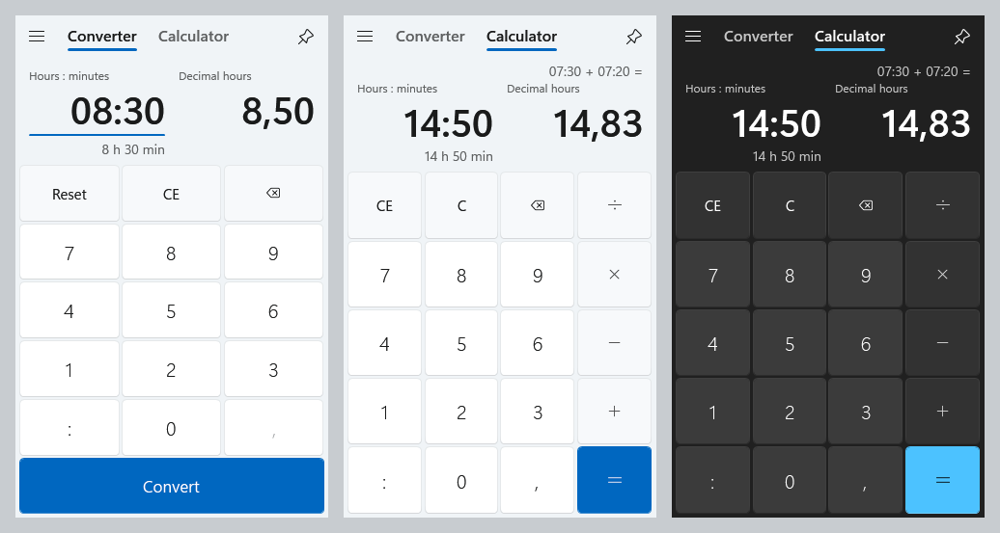
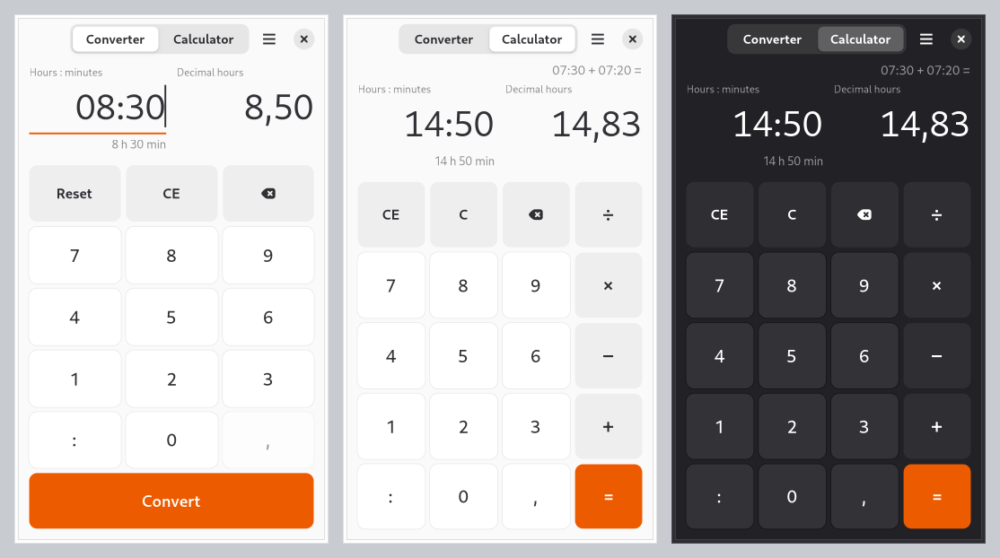
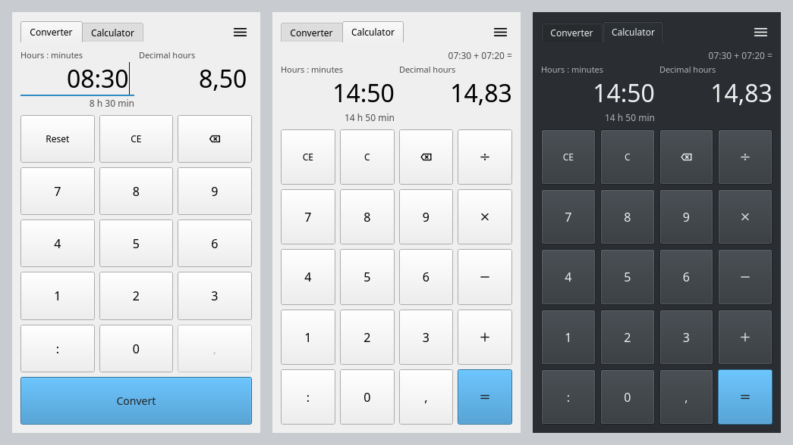

<!--
SPDX-FileCopyrightText: 2026 Optimey CommV
SPDX-License-Identifier: GPL-3.0-or-later
-->

# HourCalc

Convert between h:mm and decimal hours and calculate with hours, as a small native app for Windows and Linux.



| GNOME (GTK 4 + libadwaita) | KDE Plasma (Qt 6) |
|---|---|
|  |  |

The Linux screenshots come from the headless test renders: the Qt one uses the Fusion style, on
Plasma it picks up Breeze and the Plasma colors.

## Why

Timesheets, invoices and payroll tools want decimal hours (8,50), people think in hours and
minutes (08:30). Converting by hand is slow and error-prone, and the Windows Calculator cannot add
07:30 and 07:20. HourCalc does both in one small window that looks like the Windows 11 Calculator.
On Windows it is one portable exe that opens in about a tenth of a second.

It is native on every platform: C++ and Win32 on Windows (no .NET, no runtime to install, no
DirectX), GTK 4 with libadwaita on GNOME and Qt 6 on KDE Plasma. All three share one C++ core whose
arithmetic is tested against a C# reference implementation over more than 38 million cases.

## Requirements

To run it:

- Windows 10 (1809 or later) or Windows 11, x64.
- Debian 13 (trixie) or Ubuntu 26.04 LTS, amd64, with GNOME or KDE Plasma (it runs on other
  desktops too, with the GTK front end).

To build it:

- Windows: Visual Studio Build Tools 2022 with the C++ x64 toolset, the Windows SDK and Windows
  PowerShell 5.1. The tests also need the .NET SDK (the C# reference is compiled with its Roslyn
  compiler). Redrawing the icon needs Python with `resvg_py` and `Pillow`.
- Linux: `build-essential debhelper meson ninja-build pkgconf libgtk-4-dev libadwaita-1-dev
  qt6-base-dev`, plus `lintian desktop-file-utils appstream` for the package checks and `xvfb
  xauth` for the headless GUI tests.

## Installation

**Windows:** download `HourCalc-<version>-windows-x64.exe` from the
[releases](https://github.com/Optimey-CommV/hourcalc/releases) and run it. It is portable: there
is nothing to install.

**Debian 13 and Ubuntu 26.04:** add the Optimey APT repository and install the package; updates
then arrive with the normal system updates.

```sh
# Debian 13
sudo wget -O /etc/apt/sources.list.d/optimey.sources https://apt.optimey.be/debian13.sources
# Ubuntu 26.04 LTS
sudo wget -O /etc/apt/sources.list.d/optimey.sources https://apt.optimey.be/ubuntu26.04.sources

sudo apt update
sudo apt install hourcalc
```

The `.sources` file carries the repository's public key, "Optimey CommV APT repository", fingerprint
`A243 70A9 56BF B9F0 FE66 D1D7 332E 513D AD86 6F27`. The same `.deb` files are on the releases page.

### Building from source

```sh
git clone https://github.com/Optimey-CommV/hourcalc.git
cd hourcalc
```

#### Windows

```powershell
powershell -NoProfile -ExecutionPolicy Bypass -File build.ps1
```

This builds `dist\HourCalc.exe` and runs all tests (C++ unit tests, the C# reference tests, the
differential tests against the reference and the headless UI self test). `-SkipTests` builds only.
The result is one portable exe of about 200 KB: copy it anywhere and run it.

#### Linux

On Debian 13 or Ubuntu 26.04:

```sh
bash tools/build-deb.sh
sudo apt install ../hourcalc-deb/result/hourcalc_1.0.0-1~*_amd64.deb
```

`tools/build-deb.sh` builds in a clean copy next to the repository (`../hourcalc-deb/`), runs
`dpkg-buildpackage -us -uc -b` and checks the package with `lintian`, `desktop-file-validate`,
`appstreamcli validate` and `apt-get install --simulate`. The package `hourcalc` holds both front
ends; `hourcalc` starts the Qt one on KDE and the GTK one everywhere else.

Without a package: `meson setup build --prefix=/usr && ninja -C build && meson test -C build`
(`-Dgtk=false`, `-Dqt=false` and `-Dtests=false` leave parts out).

From Windows, `tools\build-deb.ps1 -Distro Debian|Ubuntu|Both` builds the packages in the WSL
distros of the same name and copies them to `dist\linux\`.

## Usage

**Converter tab.** Two fields: hours and minutes on the left, decimal hours on the right. Type in
either one and the other follows at once.

| you type | the other field shows |
|---|---|
| `08:30` | `8,50` |
| `8,50` (right) | `08:30` |
| `830`, `8.30`, `8u30`, `8h30` | `8,50` |
| `0:90` | `1,50` (minutes carry) |

**Convert** tidies the active field (`8:3` becomes `08:03`, `8,5` becomes `8,50`), **Reset** empties
both fields and **CE** the active one. Times round to the nearest minute, decimals to 2 places by
default, so converting back and forth is exact to the minute.

**Calculator tab.** Calculates with durations, left to right like the Windows Calculator:

- `07:30 + 07:20 =` gives `14:50` and `14,83`.
- An entry is `7:30` (hours and minutes), `7,5` (decimal hours) or `8` (whole hours).
- `+` and `-` add and subtract durations; `*` and `/` take the second number as a factor:
  `7:30 * 2 = 15:00`.
- `=` again repeats the last operation. Negative results are fine. Division by zero and results of
  10 000 000 hours or more show an error.

**Menu.** Theme (Auto follows the system, or Light or Dark), the number of decimal places (2 to 6)
and About, with the license.

Keyboard:

| key | action |
|---|---|
| `Ctrl+1`, `Ctrl+2`, `Ctrl+Tab` | switch tab |
| digits, `:` `u` `h`, `,` `.` | type a value (time separator, decimal separator) |
| `+` `-` `*` `/` | operators (calculator) |
| `Enter` | Convert, or `=` |
| `Esc` | Reset, or C |
| `Backspace` | edit the value |
| `Delete` | CE (calculator) |
| `Ctrl+C`, `Ctrl+Shift+C`, `Ctrl+V` | copy the h:mm value, copy the decimal value, paste (calculator) |

Numbers follow the regional settings of Windows or the locale on Linux (decimal comma or point).

## Configuration

HourCalc keeps two settings, and writes them only when you change one in the menu:

| system | file |
|---|---|
| Windows | `%LOCALAPPDATA%\HourCalc\HourCalc.ini` |
| Linux | `$XDG_CONFIG_HOME/hourcalc/hourcalc.ini` (usually `~/.config/hourcalc/hourcalc.ini`) |

```ini
DecimalPlaces=3
Theme=dark
```

`DecimalPlaces` is 2 to 6 (default 2), `Theme` is `auto`, `light` or `dark` (default `auto`). A
missing or invalid value means the default; delete the file to go back to the defaults. Nothing is
written next to the exe, no admin rights are needed and nothing goes into the registry.

The design documents in [docs/](docs/) describe the behaviour in detail (`SPEC.md`), the Windows
build (`NATIVE.md`, `SIZE.md`) and the Linux build and the APT repository (`LINUX.md`).

## Contributing

Issues and pull requests are welcome. Contributions are accepted under the same license as the project. Before your first commit, run `pre-commit install`: the hooks check for secrets, private IP addresses and missing license headers. Every file carries its copyright and license in a header or through `REUSE.toml` ([REUSE](https://reuse.software/)). Behaviour changes in the core belong in the C# reference in `oracle/` as well, so that the differential tests keep both in step.

## Security

Report vulnerabilities privately, as described in the [security policy](https://github.com/Optimey-CommV/.github/blob/main/SECURITY.md).

## License

Copyright (C) 2026 Optimey CommV

This program is free software: you can redistribute it and/or modify it under the terms of the GNU General Public License as published by the Free Software Foundation, either version 3 of the License, or (at your option) any later version.

This program is distributed in the hope that it will be useful, but WITHOUT ANY WARRANTY; without even the implied warranty of MERCHANTABILITY or FITNESS FOR A PARTICULAR PURPOSE.  See the GNU General Public License for more details.

You should have received a copy of the GNU General Public License along with this program.  If not, see <https://www.gnu.org/licenses/>.

The AppStream metadata file (`linux/data/hourcalc.metainfo.xml.in`) is licensed under CC0-1.0, as
AppStream requires.

Made by [Optimey](https://optimey.be).
